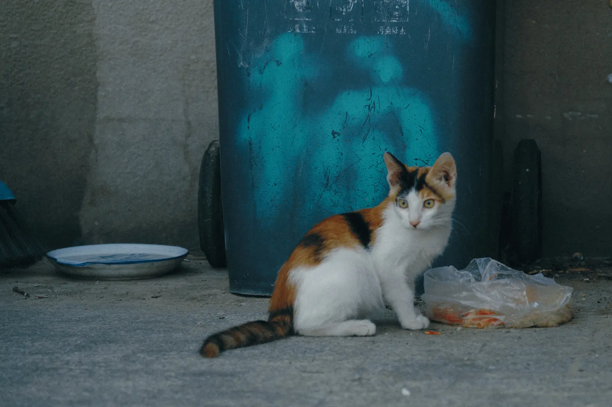
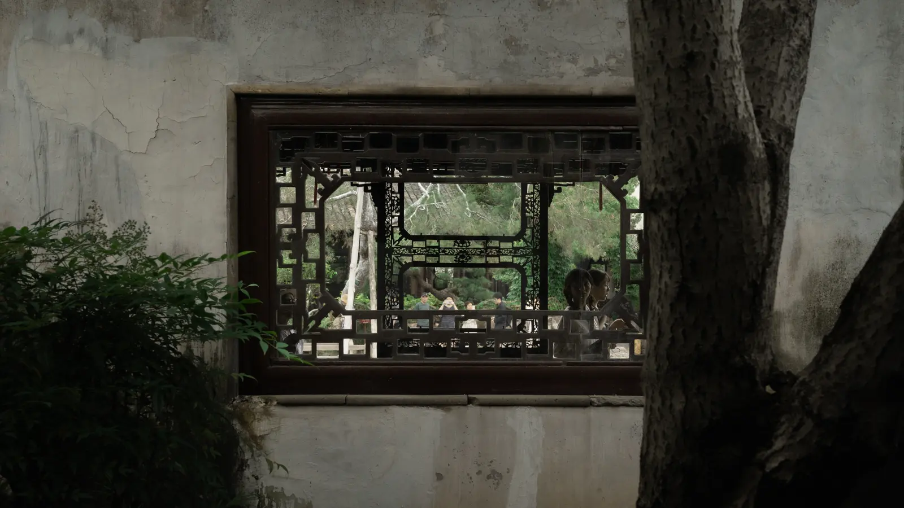

# 作家之眼 · writer-eye

> 给一张照片配一段「主旨 + 题记」。不是描述照片，是用某位作家看世界的方式看一遍，再写下来。

一个给 AI Agent 用的技能包（skill）。支持**鲁迅、村上春树、汪曾祺、余华、太宰治、迟子建、王小波、小林一茶**八位作家；可以让 AI 按画面推荐，也可以整文件夹批量。

**English** — A photography-captioning skill for AI agents. Instead of describing a photo, it writes through the eye of a specific writer: first find the silent *heart of the writing* (文心), then rebuild it with that writer's own materials, relationships and cadence. Eight writers, two validators, fully offline.

---

## 为什么不是「描述照片」

AI 看图很准，写出来却常常是清单：

> 雪山下有一间白墙红顶的房子，四周是草坡。

准确，但没有回味。同一张照片，迟子建会这样写：

> 这样的天，屋里该生火了。
> 草黄得厚，一直铺到房根底下，白墙红顶就看着暖和。
> 烟囱没冒烟，兴许是柴还没劈好。

差别不在句子长短，在**先有一句没说出口的话**：屋里该生火了。后面所有材料都围着这句话转——这是刘勰说的「文心」，也是这个 skill 的核心。

## 五个示例

示例照片与完整写作过程在 [`examples/`](examples/)，每条都附「文心」与「材料怎么碰」。

| 照片 | 示例 |
|---|---|
|  | **迟子建｜找自己家**<br>楼在对岸，那么远，玻璃上全是天光。<br>两个人站在水边，谁也没说话，就那样看着。<br>天黑之前，总能认出一扇自己的窗吧。 |
|  | **小林一茶｜都空着**<br>空盘子放在猫跟前，它抬眼看我。<br>我兜里什么也没有。<br>大热天的，谁也别怪谁。 |
|  | **村上春树｜以为有出口**<br>两排灯在桥底下排得整整齐齐，一直排到看不见的地方。<br>我顺着它们走，以为走到头会有一个出口。<br>走到一半才想起来，灯只是灯，不认得路。 |
|  | **鲁迅｜隔着一堵墙**<br>花窗把园子分成一格一格。<br>里头的人看花，说话，不朝外看。<br>墙里看花，墙外看窗。 |
|  | **王小波｜中间空着**<br>一圈灯全朝外，中间空出一块。<br>我站到中间，正好落在管不着的地方。<br>就是这儿什么也没有，白自由一场。 |

## 安装

这个 skill 是一个目录：根目录放 `SKILL.md`，其余是参考资料与脚本。任何支持 skills 的 Agent 都可以直接装。

### DeepSeek Harness（DSH）

```bash
git clone https://github.com/starryj/writer-eye.git ~/.dsh/skills/writer-eye
```

Windows PowerShell：

```powershell
git clone https://github.com/starryj/writer-eye.git "$env:USERPROFILE\.dsh\skills\writer-eye"
```

如果想把仓库留在别处、只在技能目录里放一个链接，用 junction（不需要管理员权限）：

```powershell
cmd /c mklink /J "%USERPROFILE%\.dsh\skills\writer-eye" "D:\path\to\writer-eye"
```

### 其他 harness

把整个目录放进对应的 skills 目录即可，例如 Claude Code 的 `~/.claude/skills/writer-eye/`。`SKILL.md` 的 frontmatter 只有 `name` 与 `description`，通用。

## 用法

装好后直接说：

- 「用鲁迅的笔调给这张照片写个题记」
- 「作家之眼，给这个文件夹里的照片各配一条」
- 「这张照片，你觉得该用谁的眼睛看？」（不指定作家 → 按画面推荐）

输出格式固定：

```
笔调：迟子建
主旨：找自己家
题记：
楼在对岸，那么远，玻璃上全是天光。
两个人站在水边，谁也没说话，就那样看着。
天黑之前，总能认出一扇自己的窗吧。
（字数：主旨 4/7，题记 46/99，3 行）
```

**它不自带识图，用的是你的 agent 的读图能力。** DSH 里读图工具是 `read_image`；Claude Code 这类直接把图片放进上下文；纯文本模型可以用本地 OCR／图像理解工具兜底（例如 `modlens_read_image`）——那是可选项，不是安装依赖。

## 它是怎么工作的

### 四步落笔，顺序不能颠倒

1. **定文心**——动笔前先问：这张照片让这个人心里说了一声什么？这句话**不写进题记**。村上看到同一间雪山小屋，文心是「我怎么在这儿」；迟子建是「屋里该生火了」；鲁迅是「住这儿的人冬天怎么过」。
2. **换成他的材料**——同一个文心，八个人会拿不同的东西去承：村上拿地图、口袋、想不起来；迟子建拿火、柴、烟囱；鲁迅把山水只当作「人怎样活着」的症候。
3. **让两样东西碰一下**——不是罗列，是并置：大×小、近×远、动×静；有「我」在场时，让「我」跟画面里的东西交手（物立一条规矩 → 我按常理去办 → 规矩把我弹回来）。落差本身就是情绪。
4. **用他的口气说完**——虚词、停顿、句长按作家各自的尺子，不统一。末句是「话」，不是判定。

**最硬的检验：换个署名，句子如果照样成立，就是共用模板，作废重写。**

### 情绪四查

- [ ] 一眼有情绪（读完不是「写得准」，是「啊」）
- [ ] 文心在里面（那句没说出口的话，读者能感到，不是能读到）
- [ ] 有人卡着（有具体的人或物卡在「该怎样却没怎样」的处境里，「我」站在旁边，不站在画面外）
- [ ] 换署名不成立

### 八条硬规则

不署作家名（「笔调」行除外）、不搬原文、不编造、不为味道虚构声音颜色、不共用模板、不写情绪词（荒凉/孤独/温暖/惆怅）、不消费作家生平、人像不猜身份不写心理。

> 方法论一句话：**借三样，不借句法。** 借他看的方式、借他的材料、借他的情绪；不借「然而」起行这类可机械照抄的句法。

## 八位作家

| 作家 | 他先看什么 | 他拿什么写 | 末句怎么收 |
|---|---|---|---|
| 鲁迅 | 人身上的旧痕、门与墙、看客 | 短句带文言余韵，诊断者口吻 | 反问或冷的短判断 |
| 村上春树 | 现代物件、迷路的「我」 | 长句逗号连缀，平白 | 一个念头 |
| 汪曾祺 | 吃食、草木、器物、手艺 | 白描短句，蹲下来看 | 手艺评语，轻轻荡开 |
| 余华 | 身体、劳动、磨损 | 极简短句，只写动作与结果 | 一个动作或一句否定 |
| 太宰治 | 脸、夜、酒、羞耻 | 口语长句，句尾发软 | 自我否定或辩解 |
| 迟子建 | 火、柴、炕、炊烟 | 绵密温润，替屋里人打算 | 家常打算或惦记 |
| 王小波 | 规则、动物、人跟体制错位的那一下 | 白话推演，忽然一句大实话 | 大白话理趣，越短越好 |
| 小林一茶 | 小东西、自己的穷日子 | 一口气两三顿，跟东西说话 | 一声轻的自嘲或季语 |

每位作家的完整档案在 [`references/writers/`](references/writers/)，开头六行「材料宇宙」（材料／关系／情绪／尺子／末句／互动）回答「他为什么不是别人」。

## 两个校验脚本

只用 Node 内置模块，无依赖，Node 18+。

**查一条题记的字数与形状**：

```bash
node scripts/check_caption.mjs "找自己家" "楼在对岸，那么远，玻璃上全是天光。
两个人站在水边，谁也没说话，就那样看着。
天黑之前，总能认出一扇自己的窗吧。"
```

三级输出：`FAIL` 硬规则（必须改）、`WARN` 真问题（主旨重复、同字开头、分号串事实、末句写情绪词）、`TIP` 节奏提示（三行太匀、没有短句、末句太长、全用句号）。**TIP 只是提示，不是规矩**；加 `--strict` 才把 WARN 升成 FAIL。

脚本只查形状，不查味道——味道靠上面那「情绪四查」。

**查一份作家档案是否合格**：

```bash
node scripts/check_dossier.mjs references/writers/鲁迅.md 鲁迅
```

## 目录结构

```
writer-eye/
├── SKILL.md                技能主体：什么时候用、四步落笔、自检、输出格式
├── CREDITS.md              致谢与来源（nuwa-skill、文心雕龙、示例照片）
├── references/
│   ├── reading.md          读图五步：形式 → 内容 → 事实 → 换眼睛 → 落笔
│   ├── rules.md            字数口径、八条红线、软提示、情绪四查、自检清单、失败样例
│   └── writers/            八份作家档案（〇材料宇宙 + 11 项结构 + 三组示范）
├── scripts/
│   ├── check_caption.mjs   题记体检
│   └── check_dossier.mjs   档案体检
└── examples/               5 张示例照片 + 每条题记的写作过程
```

## 前置条件：它需要一个能看图的 agent

这个 skill 里没有一行「读图代码」，它调用的是 agent 自己的读图能力。所以：

| 你的 agent | 能不能用 | 怎么读图 |
|---|---|---|
| DSH、Claude Code、Codex 等支持图片输入的 harness | 可以 | 自带 `read_image`，或直接把图片放进上下文 |
| 模型没有视觉，但装了 OCR／图像理解工具 | 可以，画面靠工具转述 | 选装本地视觉桥（如 `modlens`），先转成文字描述再写 |
| 纯文本模型，且没有任何读图工具 | 不行 | 只能你口述画面，写出来的是转述你的话，不是看照片 |

换句话说：**装这个 skill 不需要任何插件；需要的是「能看到照片」这件事本身。** `modlens_read_image` 只是作者本机的一个可选兜底，不是依赖。

## 已知限制

- 需要「能看图」这件事成立（agent 自带读图或模型本身有视觉）；纯文本模型只能靠用户口述画面。
- 档案里部分示范引用了作者自己的照片文件名，那些原图不在本仓库内。
- 目前八位作家，都是公版或现代作家；新增一位按 `SKILL.md` 第六节的五步走，示范必须用真实照片，不许三张共用一个套路。
- 不做长文、不做散文全文、不模仿原文句子；它只写看得见的东西。

## 关于示例照片

`examples/` 里的 5 张照片 © 十一，授权用于本仓库演示，**不随 MIT 许可转授**，请勿另行使用。文中其余被引用的照片只在档案里以文件名出现，原图不随仓库分发。

## 致谢与来源

- **nuwa-skill**（[alchaincyf/nuwa-skill](https://github.com/alchaincyf/nuwa-skill)，MIT）：方法论成形阶段以它的「快速档」蒸馏作了 A/B 对照组——鲁迅 + 3 张照片的盲测中，手写稿 3:0 胜出，由此得出「借看不借句法」；鲁迅档案第 7 项「他会先看照片的什么」来自它的蒸馏稿，经改写融合。本项目未复制其代码或文本。详见 [CREDITS.md](CREDITS.md)。
- 「文心」取自刘勰《文心雕龙·序志》：「夫文心者，言为文之用心也。」
- 「借三样，不借句法」来自多轮对写与盲测：第一轮只把句子切短，四家写成同一个人换三种口音；第二轮换成各家自己的材料与关系，才立住。
- 「情绪四查」里的「有人卡着」，来自几次返工的共同病灶：句子再准，没有人卡在处境里，就还是浅。

## License

MIT，见 [LICENSE](LICENSE)。
