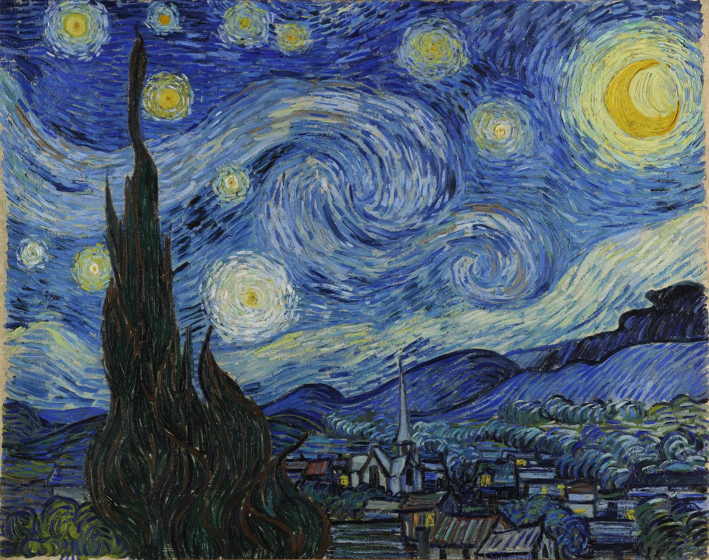

# 01｜村上春树｜都没睡

**画作**：Vincent van Gogh《星夜》（The Starry Night），1889，纽约现代艺术博物馆（MoMA）

> 示例只看画，不写画家、笔触、流派、名气与创作背景——把它当一张照片。

**主旨：都没睡**

> 半夜醒过来，天上那圈云还在拧，月亮边上糊着一团黄。
> 底下是一排屋顶，一个塔尖，几扇还亮着的窗，看样子也没睡。
> 我想，睡不着的不止我一个，就把灯关了。

| 项 | 内容 |
|---|---|
| 文心（不写出来的那句） | 半夜醒着的，不止我一个；那我就把灯关了。 |
| 材料与碰撞 | 天上的云在拧、月亮糊成一团黄 × 底下一排屋顶、一个塔尖、几扇还亮的窗。先让「我」从别人的窗里认领同类，再做一个收束动作——「关灯」是把「我」交回夜色，不是收场。 |
| 档位 / 站位 | A 人×物（我 × 窗与夜色）／进场 |
| 校验 | PASS｜主旨 3/7 ｜ 题记 62/99 字，3 行 / 3 句 |
| 不写什么 | 不写梵高、不写后印象派、不写「燃烧的星空」；画面里是云在拧，不是星星在转。 |
