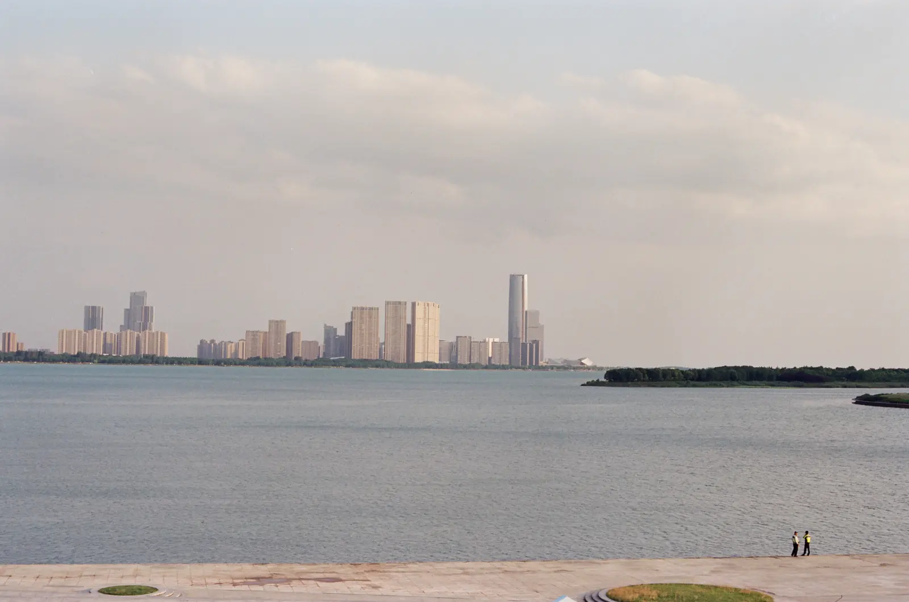

# 01｜迟子建｜找自己家

**主旨：找自己家**

> 楼在对岸，那么远，玻璃上全是天光。
> 两个人站在水边，谁也没说话，就那样看着。
> 天黑之前，总能认出一扇自己的窗吧。

| 项 | 内容 |
|---|---|
| 文心（不写出来的那句） | 这两个人看的是哪一扇窗 |
| 材料与碰撞 | 楼群远而大 × 人小。这一位不写「辽阔」，她惦记的是人天黑前能不能认出自家窗。 |
| 档位 / 站位 | A 人×物 / 不进场（照顾型） |
| 校验 | PASS｜主旨 4/7 ｜ 题记 46/99 字，3 行 / 3 句 |
