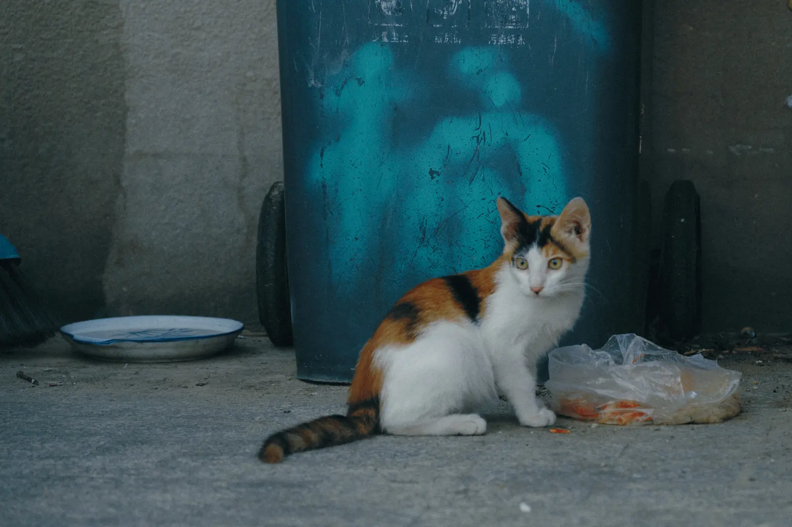

# 02｜小林一茶｜都空着

**主旨：都空着**

> 空盘子放在猫跟前，它抬眼看我。
> 我兜里什么也没有。
> 大热天的，谁也别怪谁。

| 项 | 内容 |
|---|---|
| 文心（不写出来的那句） | 我也空着手，跟它一样 |
| 材料与碰撞 | 空盘 × 空手。跟猫说话，最后把自己也放进穷日子里（季语：大热天）。 |
| 档位 / 站位 | A 人×物 / 进场（说话型） |
| 校验 | PASS｜主旨 3/7 ｜ 题记 30/99 字，3 行 / 3 句 |
