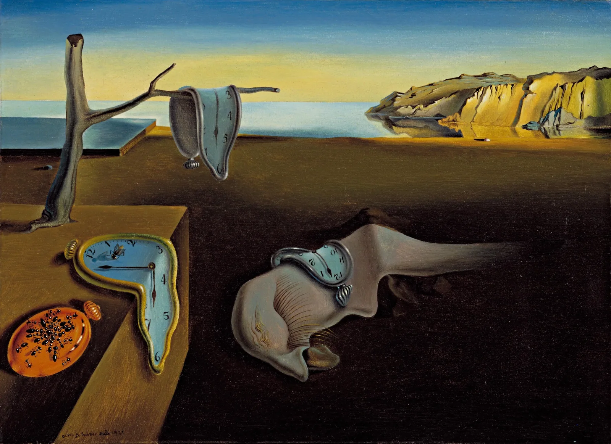

# 04｜王小波｜软的规矩

**画作**：Salvador Dalí《记忆的永恒》（The Persistence of Memory），1931，纽约现代艺术博物馆（MoMA）

> 示例只看画，不写画家、笔触、流派、名气与创作背景——把它当一张照片。

**主旨：软的规矩**

> 表都软了：一只搭在台子边上，一只挂在树杈上，一只盖在闭着眼的脸上。
> 中间那块橙色的，蚂蚁排着队往上爬，爬得挺有秩序。
> 我琢磨，这地方大概有条规矩——东西可以软，不许掉下来。

| 项 | 内容 |
|---|---|
| 文心（不写出来的那句） | 东西可以软，可这地方有条规矩——不许掉下来。 |
| 材料与碰撞 | 三只软表（台边、树杈、脸上）× 一群排队爬的蚂蚁。把「软」当规则来推：软到什么程度、谁在管秩序，最后落一句大白话的规矩。 |
| 档位 / 站位 | A 人×物／进场（我琢磨） |
| 校验 | PASS｜主旨 4/7 ｜ 题记 72/99 字，3 行 / 3 句 |
| 不写什么 | 不写达利、不写超现实主义、不写「梦境」「潜意识」「时间流逝」这类现成词。 |
