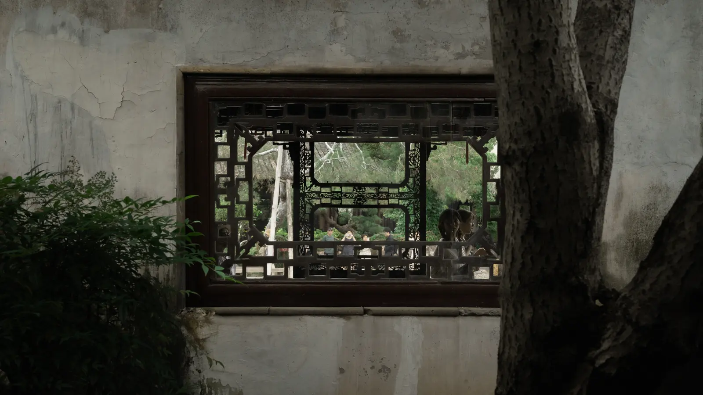

# 04｜鲁迅｜隔着一堵墙

**主旨：隔着一堵墙**

> 花窗把园子分成一格一格。
> 里头的人看花，说话，不朝外看。
> 墙里看花，墙外看窗。

| 项 | 内容 |
|---|---|
| 文心（不写出来的那句） | 窗是给外头的人看的，里头的人不看 |
| 材料与碰撞 | 修得讲究的花窗 × 窗后走过去的人。「我」被放在墙外——被隔住的那一个；末句对仗，冷里有不平。 |
| 档位 / 站位 | A 人×物 / 不进场（旁观型） |
| 校验 | PASS｜主旨 5/7 ｜ 题记 31/99 字，3 行 / 3 句 |
