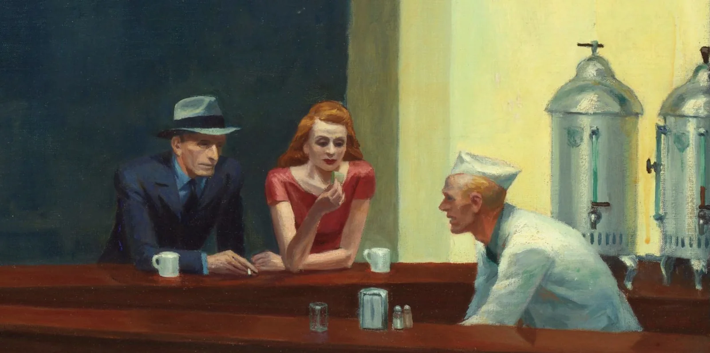

# 05｜余华｜各坐各的

**画作**：Edward Hopper《夜游者》（Nighthawks），1942，芝加哥艺术博物馆

> 示例只看画，不写画家、笔触、流派、名气与创作背景——把它当一张照片。

**主旨：各坐各的**

> 灯照着台面，台面发白。
> 三个人，三只杯子，男人低着头。
> 红衣服的女人手里捏着一点绿，白衣的弯下腰。
> 谁也没看谁。

| 项 | 内容 |
|---|---|
| 文心（不写出来的那句） | 三个人坐一块儿，谁也没看谁。 |
| 材料与碰撞 | 灯、台面、三只杯子、三个人的姿势 × 红衣服女人手里那点绿。只写动作与位置，不写气氛；末句只剩一个否定。 |
| 档位 / 站位 | A 人×物／不进场（旁观） |
| 校验 | PASS｜主旨 4/7 ｜ 题记 45/99 字，4 行 / 4 句（一句一个动作） |
| 不写什么 | 不写霍珀、不写「孤独」「疏离」、不写他们在想什么；不写深夜的城市。 |
