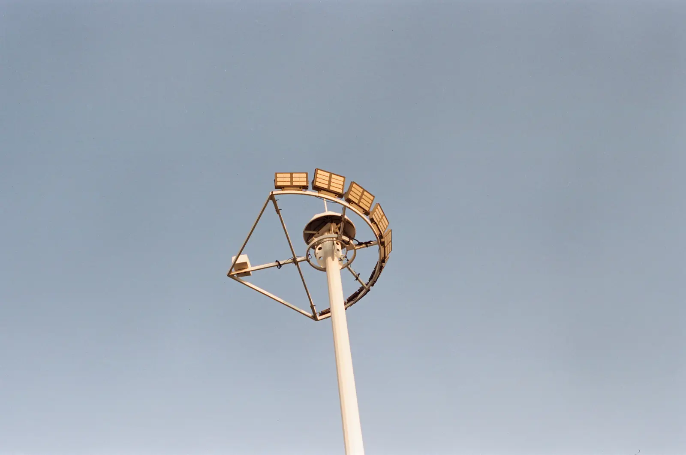

# 05｜王小波｜中间空着

**主旨：中间空着**

> 一圈灯全朝外，中间空出一块。
> 我站到中间，正好落在管不着的地方。
> 就是这儿什么也没有，白自由一场。

| 项 | 内容 |
|---|---|
| 文心（不写出来的那句） | 灯只照它负责的那一块，中间归没人管 |
| 材料与碰撞 | 一圈朝外的灯 × 中间的空地。站进去就有代价：管不着的地方，也什么都没有。 |
| 档位 / 站位 | A 人×物 / 进场（出题型） |
| 校验 | PASS｜主旨 4/7 ｜ 题记 41/99 字，3 行 / 3 句 |
